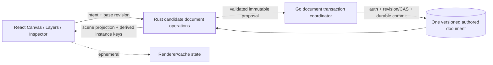

# FG-C3.2 — Canonical Component Ownership and Identity (ADR Proposal)

**Status:** Proposed for Chief Architect decision; not approved for production adoption  
**Baseline:** `eec49e9e83087c1aa06f78e306b219cf3b0b7cf5`  
**Scope:** Ownership, identity, and transaction design for components, sets, instances, overrides, and slots. No runtime implementation or saved-file change is authorized.

## Decision summary

**Recommendation:** Put component semantics in the one versioned document aggregate, with the existing main component subtree serving as the definition graph rather than copying it into another registry. Keep component/set metadata on document-owned records keyed by stable IDs; keep instance source, variant selection, overrides, and authored slot content on its scene instance record. Treat expanded instance children as a projection with derived identities, not as a second authored tree. Use the Rust `logos-types` document core as the candidate deterministic semantic/operation implementation, while the durable document transaction remains revision-fenced by the Go service. React/Zustand becomes an editor projection and command client only after an explicit migration gate.

This recommendation does **not** transfer current production authority to Rust or change Go persistence. The Rust core is presently disconnected from React writes, Go RPCs, and saved-document reads/writes. Production adoption requires a Chief Architect decision on the execution boundary described below.



The dashed cache is disposable. The document contains one authored component graph; no React component registry or renderer expansion becomes a second source of truth.

## 1. Current-source inventory

| Lifecycle area | Current source and observed behavior | Ownership / integrity gap |
|---|---|---|
| Component promotion | [`Inspector.tsx`](../../logos-app/src/components/inspector/Inspector.tsx) gathers only the selected component's direct children into `defaultShapes`; it calls `documentStore.promoteToComponent` and then separately calls `componentStore.registerComponent`. [`documentStore.ts`](../../logos-app/src/stores/documentStore.ts) turns the scene shape into `type: "component"` and stores `componentMeta`; [`hierarchyOperations.ts`](../../logos-app/src/stores/hierarchyOperations.ts) validates/commits only the scene mutation. | Two writes, no shared rollback or transaction. The document shape and registry both describe the component; the copied defaults may become stale. Promotion keeps the existing root/child IDs, but nested definition graph completeness is not established by the direct-child snapshot. |
| Registry / definitions | [`componentStore.ts`](../../logos-app/src/stores/componentStore.ts) owns `components[id] = { name, defaultShapes, defaultChildIds, properties }` and a separate `instances` map. `registerComponent` is a Zustand write; `updateComponentDefaults` propagates copied defaults and prunes overrides. No call site for `updateComponentDefaults` was found. | Registry is in-memory only and duplicates metadata/default shapes already represented by document shapes. Updates do not atomically update the document store. Override paths that disappear are silently dropped by current prototype code. |
| Instance insertion | [`AssetsPanel.tsx`](../../logos-app/src/components/assets/AssetsPanel.tsx) and [`Canvas.tsx`](../../logos-app/src/components/canvas/Canvas.tsx) first call `componentStore.createInstance`, then `documentStore.addInstanceShape`; they compensate by removing the registry instance if scene insertion throws. `addInstanceShape` stores `instanceMeta` on the scene shape as well. | Two stores and two commits; compensation is best-effort. Component ID, properties, and overrides are represented both in the instance record and the scene shape's `instanceMeta`. |
| Instance deletion | Scene subtree deletion is handled by document hierarchy operations. `removeInstance` is called at the two insertion failure sites; no document-deletion subscription or other production call site was found. | Deleting an instance scene shape can leave a stale registry entry. Conversely, a registry-only removal can leave the scene shape. |
| Property/variant edits | [`Inspector.tsx`](../../logos-app/src/components/inspector/Inspector.tsx) updates `componentStore` and `documentStore` separately for variant and boolean values; the text path updates only the registry. Reset similarly performs separate updates. `setOverride` has no editor call site found. | Partial update/stale-copy risk; current property types (`variant`, `boolean`, `text`) are a prototype subset. No typed swap/slot transaction or explicit invalidation protocol. |
| Definition updates / propagation | `componentStore.updateComponentDefaults` shallowly snapshots defaults, applies overrides, and removes overrides for missing shape IDs. `resolveInstance` exists but no application call site was found. | No demonstrated live linked subtree, atomic propagation, orphan-override policy, or current renderer integration. |
| Canvas/Layers/Inspector projection | [`documentStore.ts`](../../logos-app/src/stores/documentStore.ts) selects the page's scene shapes and [`scene-projection.ts`](../../logos-app/src/render-wasm/scene-projection.ts) projects those records. No call to `componentStore.resolveInstance` was found in the UI or render projection. The current Canvas draws the instance shell; A9 qualification reports component rendering as unsupported. | Registry resolution is not a production scene projection. Selection, layer identity, and renderer behavior for expanded instance descendants remain unqualified. |
| Offline persistence | [`offline/persist.ts`](../../logos-app/src/offline/persist.ts) writes `documentId`, pages, page order, current page, and `shapes` to IndexedDB. It does not snapshot `componentStore.components` or `componentStore.instances`. Instance/component metadata present on a shape can survive in that shape snapshot, but the separate definition registry/defaults do not. | Reload can restore a component-shaped node or an instance shell without restoring the registry needed to resolve it. No complete component round-trip is demonstrated. |
| Undo/redo | No document undo/redo store or component undo integration was found under `logos-app/src`. The Go backend has file-change history/rebase, but its change processor handles generic add/mod/delete/move object changes, not component-domain transactions. | No atomic multi-record component inverse, redo identity rule, or component history contract is evidenced. |
| Rust document candidate | [`rust/logos-types/src/document.rs`](../../rust/logos-types/src/document.rs) defines a versioned flat `Document`, graph validation, and immutable candidate create/update/delete/reparent/reorder operations. It checks a local `component_id` link to a Component shape where no external component file is present. Its module header says it is not wired to React, Go, or saved documents. `DocumentOperation` has no promotion, set, instance-property, override, slot, propagation, or detach variant. | A viable candidate graph/operation boundary exists, but component semantics and production authority are absent. |
| Rust shape model | [`rust/logos-types/src/shape.rs`](../../rust/logos-types/src/shape.rs) has a `Component` container and fields `component_id`, `component_file`, `component_root`, and `main_instance`. | These links and flags are not the full set/variant/override/slot model. No component materializer or identity policy is present. |
| Go persistence and changes | [`backend-go/internal/filedata/filedata.go`](../../backend-go/internal/filedata/filedata.go) builds Logos file data (version 67) and advertises `components/v2` / `variants/v1` feature flags. [`backend-go/internal/changes/changes.go`](../../backend-go/internal/changes/changes.go) mutates generic page/object maps for add/mod/delete/move. Snapshot handlers store/restore file data. | Feature flags and generic JSON persistence are not evidence of a typed component transaction, component-set validation, instance expansion, or cross-client atomic propagation. |
| Legacy import / identity | [`logos-app/src/migration/sketch/sketch-shape-converter.ts`](../../logos-app/src/migration/sketch/sketch-shape-converter.ts) maps imported symbol instances into `instanceMeta`, retaining importer-supplied values where available. | No cross-format component identity mapping or round-trip is qualified; imports must preserve opaque source data or reject an unsupported conversion. |

### Current failure modes evidenced by source

1. Promotion can commit the page shape before registry registration; instance creation can commit registry state before scene insertion. These are separate stores, not one transaction.
2. The registry keeps copied component shapes and properties, while document shapes also hold component and instance metadata. Either copy can become stale.
3. Component registry data is not included in the offline document snapshot, and instance deletion is not coupled to `removeInstance`.
4. The resolver and propagation API are not wired into the renderer; there is no demonstrated expanded instance scene graph.
5. The pure Rust document candidate is not a backend validation or persistence boundary. Generic Go object edits do not make component edits atomic.

These are source-level observations. They do not assert behavior for a production deployment or undocumented plugins.

## 2. Canonical entity placement proposal

The authored document envelope should own one normalized entity graph. A candidate shape is:

```text
Document(schemaVersion, documentId, revision, pages, shapes,
         componentSets, externalReferencePins, extensions)

ComponentDefinition(id = component-root shape ID, propertyDefinitions, setId)
  definition nodes = the existing stable-ID component-root subtree in shapes

ComponentSet(id, ordered member component IDs, typed variant properties)

Scene instance = a stable-ID shape record with
  source = local component / local set + selection / external pinned ref / unresolved locator
  propertyValues, typed overrides, authored slot-content graphs
```

The `ComponentDefinition` record refers to its main root and does not copy its shape subtree. Its stable-ID child graph remains the canonical authored definition. A main component may stay visible on a page as that same root node; it must not also be represented by a second copied `defaultShapes` tree. An instance remains an authored scene node; its base source subtree is not copied into authored `shapes` merely to render it.

| Entity | Candidate canonical location | Noncanonical copies / projections |
|---|---|---|
| Definition and definition nodes | Document-owned component metadata keyed by the existing component root; node records are the root's existing stable-ID subtree. | No second `defaultShapes` registry. Renderer may cache a flattened graph keyed by document revision. |
| Component sets and ordered variant membership | Document-level `componentSets`; member IDs refer to canonical component root IDs, never names or array position. | UI grouping/order cache is derived. |
| Scene instances | Existing document scene-node record with typed source and instance fields; instance ID is stable and independent of source identity. | `ComponentInstanceDomainV1` must not become a second store. |
| Property values and overrides | On the instance record, using stable property IDs and typed target-node/field addresses. | Inspector drafts may be ephemeral; invalid/orphan values are preserved and diagnosed, not silently removed. |
| Authored slot content | Ordered, stable-ID subgraph owned by the instance and addressed by stable slot property ID. It is user-authored content, not part of the component definition. | Flattened slot projection is derived. |
| External references | Typed `(fileId, componentId, revision)` pin/reference; unresolved import locator retained opaquely. | Remote library cache is disposable and revision-keyed. Never substitute by display name. |
| Expanded children | Not authored/persisted by default; derived from instance identity + definition path + slot path. | Renderer/Canvas/Layers projection, invalidated on source revision or selection changes. |

The in-repository v1 candidate validates a standalone `{components, componentSets, instances}` envelope. That envelope is useful for semantic qualification but should be adapted into the document aggregate; it must not be persisted beside an independent scene document as another authority.

## 3. Identity policy comparison

| Policy | Stability and benefits | Risks / costs | Assessment |
|---|---|---|---|
| **Deterministic path-derived IDs**: derive each expanded child key from document namespace, scene instance ID, stable component/definition-node route, and slot-authored node route; UUIDv5 or equivalent namespaced derivation. | Same source/instance route reproduces identity across render/reload. Definition child reorder does not change identity. No mapping table and no persisted duplicate of derived children. | Depends on stable authored IDs and unambiguous route encoding. Reused definition IDs can alias old identity. Nested occurrence route and external revision namespace must be specified. A derivation collision must reject, never fall back to random IDs. | **Recommended for projection-only children**, after a pure collision/reorder test and canonical ID policy approval. Derived IDs are runtime locators, not proof that child records are persisted. |
| **Persisted instance-to-definition mapping table**: store `(instance ID, definition node ID/path) -> derived child UUID`. | Can preserve identity across definition moves, path changes, imported sources with unstable IDs, and some detach workflows. Explicit and inspectable. | Creates more canonical records and atomic updates; stale mappings on source changes; cleanup/rebase burden; collisions and conflict handling remain; easier to reintroduce duplicate authority. | Keep as a migration/import adapter option only if real fixtures prove path-derived identity insufficient. Do not make the default. |
| **Persist expanded child shape records per instance**: copy definition tree into scene document. | Every canvas item has an ordinary persisted scene ID; existing object operations can address it directly. | Duplicates source data, requires propagation to every copy, creates sync/conflict semantics, grows documents, and makes deletion/reset/detach ambiguous. Strong risk of two authorities. | Reject as default linked-instance representation. It may be a deliberate detach/materialize result, not a linked instance cache. |
| **Allocate fresh IDs at each expansion** | Simple initial implementation. | IDs change on every re-materialization; selection, override addresses, caches, and history cannot reliably refer to the same logical child. | Reject. |

### Recommended identity rules

- Component root IDs and definition-node IDs are canonical document IDs. Existing IDs survive promotion and ordinary rename/reorder/update. A deleted-and-recreated definition node receives a new authored ID; IDs are never inferred from names, sibling index, geometry, or visual similarity.
- Component-set and property IDs are stable authored identities distinct from mutable names/labels. Variant choice is an explicit value keyed by property ID; ordering is stored only where it is semantic.
- Scene instance ID is the existing scene-node ID. Changing its source does not change its scene identity. Source identity and source revision are separate fields.
- Slot-content nodes have authored stable IDs scoped or namespaced by their owner instance and slot ID; reordering keeps identity, delete/recreate gets a new identity.
- A derived child key is a pure function of the scene instance ID, local source component IDs along the nested definition-instance route, terminal definition-node ID, and applicable slot path. Reorder does not affect it. A local definition update preserves keys for surviving stable node IDs; deleting/recreating a definition node or changing the source invalidates the affected key, so stale selection/cache entries are discarded. External routes additionally include the pinned file/component/revision identity; changing the remote revision creates a new projection namespace pending an approved external-update policy. Overrides target typed definition paths, not derived runtime IDs.
- Detach is a single transaction that converts the current resolved authored projection into ordinary scene-owned nodes. It must define which derived keys are retained as new authored scene IDs and ensure no collision with existing document IDs. No detach identity conversion is implemented here.
- Local and external namespaces are disjoint. External-derived keys include file, component, pinned revision, and foreign node identity; an updated remote revision cannot silently reuse an old projected identity.

## 4. Atomic transaction proposal

All commands read one immutable document revision, plan a complete candidate, validate graph and component invariants, then commit as a single revision-fenced operation. The Go transaction coordinator checks authorization and expected revision and persists either the whole new document/operation or none. React does not write a separate component store. Rejection preserves document, component links, selection, undo history, and renderer-visible projection.

| Command | Atomic effects and rejection rules |
|---|---|
| Promote/create definition | Check selected frame/group and complete subtree, keep IDs, establish component root/definition metadata, validate links and set policy, commit once. If any step fails, scene type and definition metadata both remain unchanged. |
| Create/delete scene instance | Create/remove the instance scene node and all instance-owned payload together; validate source and page/parent constraints. Deletion removes only that instance-owned slot graph and its authored overrides, never source definition records. |
| Update definition | Apply edits to the canonical definition subtree once. Validate all referring instances, swap allow-lists, overrides, slots, and external/local links before commit. Preserve unresolved/orphaned user data with typed diagnostics or explicit user resolution; never silently prune. |
| Select variant / swap source | Validate exact set tuple or allowed target, retain stable instance and authored slot identities, invalidate derived projection atomically, and carry source revision/preconditions. |
| Set/reset override or property | Validate property kind, target identity and applicability. Reset one/all is an explicit operation. A stale target or wrong type rejects or enters an explicit preserved-orphan state; no shallow spread to arbitrary fields. |
| Slot edit | Update the ordered instance-owned content graph, validate uniqueness, parent links, slot constraints, and local-reference cycle context; publish once. |
| Detach | Materialize the selected effective tree and slot content, allocate/retain collision-free authored scene IDs under a specified identity rule, remove link metadata, and commit as one operation. |
| Undo/redo | Use typed inverse/history records with expected base revision and stable operation identity. Undo/redo must restore the same authored identity/order where the inverse is valid; conflicts reject or require explicit rebase. |

**Execution boundary required before adoption:** Rust must be the single implementation of component/document semantic validation and operation planning, but Go is the durable collaborative transaction coordinator. The recommended target is a shared Rust core invoked by Go and the React/WASM editor, with the same conformance vectors at both boundaries. A feasibility spike must prove supported native Go↔Rust invocation, deployment packaging, error/version compatibility, and atomic candidate ownership. If that cannot be made operationally supportable, the Chief Architect must choose a Go semantic owner instead; maintaining independently authored Rust and Go component engines is not an acceptable fallback.

## 5. Viable ownership alternatives

| Alternative | Advantages | Trade-offs / risks | Recommendation |
|---|---|---|---|
| **A. React/Zustand owns component model**; component entities are merged into documentStore, Go stores the document blob, renderer consumes React projections. | Smallest first migration from current UI; existing browser-only workflows remain direct. | Browser is not a trusted collaborative authority; server currently applies generic changes without component validation. Rust candidate semantics and Go revision history would drift from React unless duplicated. | Not recommended as the long-term owner. Could be a temporary editor adapter only, under the current production gate. |
| **B. Rust `logos-types` owns typed document semantics and deterministic operations; Go owns auth, revision/CAS, durable persistence; React is UI/command/projection client.** | Aligns with approved Rust candidate graph/operation direction; one semantics implementation; supports immutable validation and multiple clients. Keeps durable storage in existing Go service. | Requires a supported server invocation/build boundary for Rust. Go must not accept unvalidated component payloads; deployment/ABI/versioning and rollback need a spike. Rust currently has only partial component fields and no component ops. | **Recommended target, conditional on feasibility and Chief Architect approval.** |
| **C. Go owns typed component/document semantics and persistence; Rust is renderer geometry/projection; React is editor client.** | Server can authorize, validate, serialize, and commit in one transaction; natural collaboration/revision boundary. Avoids Rust-in-Go runtime integration. | Conflicts with the current Rust canonical-semantics candidate direction; duplicates/reimplements Rust graph operations or demotes them; migration and test conformance burden. | Viable fallback if Alternative B's server execution boundary is rejected. Chief Architect choice required. |

## 6. Compatibility and migration risks

- Existing files use legacy/Go file-data v67 and generic maps; no representative component-rich current/historical round-trip corpus has been qualified. Do not rewrite old blobs or claim the v1 candidate is a lossless adapter.
- React `componentMeta` / `instanceMeta`, `componentStore` copied records, Go `components/v2` feature flag, and Rust component flags are not equivalent wire contracts. A feature flag is not proof of model compatibility.
- Existing IDs must survive adapter round-trips. Unknown fields and unresolved foreign component references need preserve-or-reject behavior. Never regenerate identity from names or map order.
- The existing `componentStore.applyOverrides` silently ignores missing paths; migration must make that state explicit without retroactively mutating old documents.
- Selection may currently point only at scene records, while future UI may display derived children. Selection and layer APIs must carry document revision + stable semantic target path, not only a transient projection UUID.
- Rust and Go currently use different representations (typed UUID graph vs JSON/Transit-compatible maps); numeric/string normalization, null/default omission, page/root ordering, and unknown extensions need golden fixtures.
- Offline persistence currently omits the component registry. A migration must not claim complete offline support until component data is document-scoped and reload/round-trip is tested.

No changes to React mutation code, Rust authority, Go persistence, or saved-file schema are part of FG-C3.2.

## 7. Staged adoption plan

1. **Chief Architect decisions:** choose semantic owner/runtime boundary, component placement in the canonical document, derived identity policy, external revision policy, and historical unknown/orphan policy. Keep current React authority until these are recorded.
2. **Boundary feasibility spike:** compile and invoke the same Rust candidate planner from native Go and WASM; run identical document/operation vectors and compare canonical output/diagnostics. No production write path. If unsupported, decide Alternative C before more resolver work.
3. **Source fixtures and adapters:** obtain authorized representative React, Go v67, and legacy Figma-compatible component documents. Build preserve-or-reject adapters and unknown-field/ID round-trip goldens; do not migrate files in place.
4. **Pure operation contract:** add promotion, update, set membership, instance create/delete, swap/variant, override/reset, slot, detach, and inverse operations to one immutable candidate. Prove all-or-nothing and stable diagnostic order.
5. **Identity qualification:** property-test derived-key reorder invariance, source update behavior, nested route uniqueness, slot namespacing, collision detection, and detach conversion. Verify selection and override addresses survive definition reorder.
6. **Shadow read-only:** compare candidate interpretation with current React behavior on authorized fixtures. Emit sanitized diffs; do not commit candidate results or change user-visible behavior.
7. **New-document opt-in rollout:** after explicit migration authorization, write the versioned aggregate for newly created documents, gate old formats to read-only compatibility or explicit conversion, and provide rollback/export. No silent legacy migration.
8. **Existing-document migration:** only after real corpus, backups, canary, compatibility and rollback acceptance. Each document conversion is revision-fenced, preserve-or-reject, and auditable.

## 8. Chief Architect decisions required

1. Approve or reject Alternative B as the target semantic ownership direction; if rejected, choose Alternative A or C and state why.
2. Decide whether Go may invoke Rust through a native shared library, a local service boundary, or another supported mechanism; no component writes proceed before this feasibility gate.
3. Approve the one-document aggregate placement and whether component definition nodes remain the existing main component subtree.
4. Approve derived path identity as the default for linked children, including exact namespace/route encoding, or require a mapping table.
5. Define source revision pinning/update policy for external libraries and behavior when a pinned revision is unavailable.
6. Decide preserve/quarantine/reject behavior for legacy unknown component fields and orphaned overrides, without silent deletion.
7. Define undo/rebase semantics and whether detach preserves projected child IDs or issues new document-owned IDs.
8. Authorize the representative fixture corpus, server/Go-Rust feasibility spike, and eventual migration gates separately.

Until these decisions are recorded, FG-C3.2 is a **proposal only**. Production component resolver, renderer integration, persistence changes, React mutation replacement, Rust authority transfer, and schema migration remain **NOT AUTHORIZED**.
