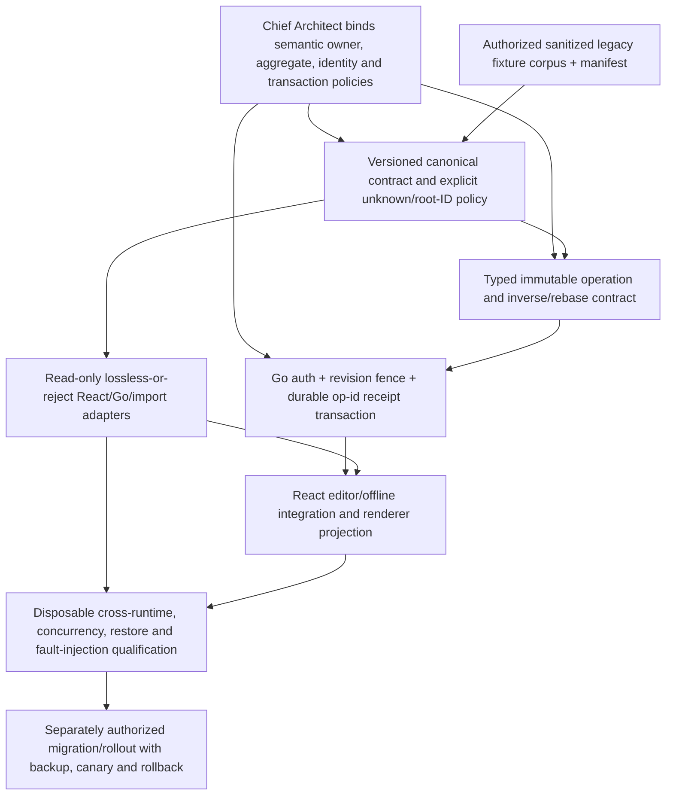

# G1-D1 — Canonical Ownership & Transaction Decision Package

**Status:** Documentation and source audit prepared for Chief Architect decisions; no ownership transfer or implementation authorized.
**Baseline:** `eb8d19c5a790386233554bdd5d1501982cc5cc90`
**Branch:** `core/g1-b9-6-memory-evidence-foundation`
**Audit scope:** The six architecture records named by the directive, plus current React, Rust, Go, and renderer source paths referenced below. No production system or customer document corpus was accessed.

## Executive recommendation

Logos does not currently have one end-to-end canonical Document owner. Its actual behavior spans React/Zustand mutations, Go legacy file-data persistence and revision handling, Rust candidate semantics, offline browser storage, and a derived renderer scene. Existing proposals generally agree on separating semantic rules, durable transaction authority, editor state, and rendering, but they do **not** bind one approved production model or execution boundary.

**Recommended policy direction for Chief Architect decision:**

1. Keep Go as durable file, authorization, and database transaction authority unless a separately approved migration changes that boundary.
2. Select one versioned document semantic contract and one implementation owner before introducing a new write path. Rust `logos-types` is a candidate, not current production authority; Go ownership and retaining the legacy Transit-compatible document contract remain viable alternatives.
3. Keep React as the editor interaction/projection layer and keep renderer IDs and scene state derived. Preserve its current production role until a new contract and migration path are approved.
4. Make a future operation commit carry an explicit document identity, `vern`, base `revn` policy, stable operation ID, authenticated actor context, and a durable operation receipt. Current local counters and server-generated change-row IDs do not supply retry idempotency.
5. Put component definitions, sets, instances, variants, overrides, and authored slot content in one chosen document-owned aggregate only after the identity and compatibility decisions below. Do not treat the existing React `componentStore`, Rust shape fields, or Go feature flags as proof that this is already true.
6. Preserve existing document bytes and identities. Do not migrate until authorized, sanitized representative legacy fixtures demonstrate lossless conversion or explicit rejection.

These are recommendations for approval, not adopted contracts. The Chief Architect must resolve the decisions in [Unresolved decisions](#unresolved-chief-architect-decisions) before production-bound implementation.

## Claim classification and source evidence

The labels below distinguish actual behavior from proposals. “Existing production behavior” means present source behavior, not a conclusion that all production deployments execute that exact version. “Candidate” means executable in tests/spikes but not wired as the production authority.

| Claim | Classification | Current evidence | Qualification boundary |
| --- | --- | --- | --- |
| React document state and hierarchy actions own interactive page/shape edits. | **Existing production behavior** | `documentStore` holds pages, root membership, current page, and shapes; creation and hierarchy actions commit to Zustand. [documentStore.ts](../../logos-app/src/stores/documentStore.ts#L25) | It is an in-memory editor representation without an authoritative server revision in the store. |
| TypeScript `componentInstanceDomainV1` is the current v1 semantic reference. | **Existing source contract / tested module** | FG-C3.1/FG-C3.3/FG-C3.4 identify the module and its fixtures as reference. It is not integrated into current production mutations or persistence. [FG-C3.1](FG-C3.1-COMPONENT-INSTANCE-DOMAIN-V1.md) | Semantic reference does not mean a production acceptance gate is already wired. |
| Rust `logos-types::document::Document` owns current production document semantics. | **False; candidate only** | The module itself says the additive contract is not wired to React, Go, or saved reads/writes. It defines schema v1, graph validation, candidate operations, and extension envelopes. [document.rs](../../rust/logos-types/src/document.rs#L1) | No canonical adoption, migration, Go invocation, or persisted contract is approved. |
| Go owns durable file bytes and normal update revision serialization. | **Existing production behavior** | `UpdateFileHandler` locks the file row and commits `file_change`, incremented `file.revn`, and `file.data` in one transaction. [files_update.go](../../backend-go/internal/handler/files_update.go#L180) | It applies the legacy change representation; this does not make Go a typed domain validator or prove exactly-once requests. |
| Go's `revn` is compare-and-swap. | **Not true in current implementation** | Future `revn` rejects, but lower stale bases load history and may be OT-rebased and committed. [files_update.go](../../backend-go/internal/handler/files_update.go#L206) | `vern` is checked for equality. The meanings and response contract need a binding decision. |
| React component definitions and instances have one persisted owner. | **False in current source** | `documentStore` shapes include component/instance metadata; `componentStore` separately holds `components` and `instances`, copied defaults, and overrides. Inspector promotion calls document mutation then registry registration as separate calls. [componentStore.ts](../../logos-app/src/stores/componentStore.ts#L1), [Inspector.tsx](../../logos-app/src/components/inspector/Inspector.tsx#L120) | `componentStore` is not in the IndexedDB `documentStore` snapshot; split state can be lost or diverge. No atomic transaction joins the stores. |
| Rust `Shape` component fields provide the full Component/Instance domain. | **Candidate fields only** | Rust `Shape` has component-link flags/IDs. Full Component/Instance v1 DTO and validator are separate spike modules, not the canonical `Document` aggregate. [shape.rs](../../rust/logos-types/src/shape.rs#L135), [FG-C3.3](FG-C3.3-COMPONENT-INSTANCE-TYPED-SCHEMA.md) | Definitions, sets, variants, overrides and slots are not shown to be persisted or executed by production Rust. |
| Renderer scene IDs and synthetic root are durable document identity. | **False; derived projection** | React `scene-projection` creates nil UUID root with `synthetic: true`, rejects source collisions, and maps only source shapes as non-synthetic nodes. [scene-projection.ts](../../logos-app/src/render-wasm/scene-projection.ts#L91) | Do not persist projection IDs or confuse them with authored document identity. |
| Offline queue identity proves server deduplication. | **False; local-only** | IndexedDB uses auto-increment `opId` and `localClock`; the sync callback receives a patch. `WorkspacePage` creates the default SyncManager without network adapters, whose defaults are stubs. [persist.ts](../../logos-app/src/offline/persist.ts#L68), [sync.ts](../../logos-app/src/offline/sync.ts#L311), [WorkspacePage.tsx](../../logos-app/src/pages/WorkspacePage.tsx#L77) | No production server acknowledgment or durable operation-key lookup is established by these local identifiers. |
| G1-B1/G1-B4/FG-C3.2 are approved production contracts. | **Proposed architecture** | G1-B1 labels itself proposed; G1-B4 is a proposed compatibility contract; FG-C3.2 is an ADR proposal with execution and migration gates. | They are useful options and requirements, not adoption decisions. |
| G0-B's snapshot findings describe current Go source. | **Outdated source claim** | Current `files_snapshot.go` locks the file, checks permission under transaction-held membership locks, writes metadata/blob atomically, verifies integrity, and restores file data plus pre-restore recovery point and thumbnail invalidation atomically. [files_snapshot.go](../../backend-go/internal/handler/files_snapshot.go#L250) | The old G0-B snapshot paragraph and source comment “partial in Go” are stale. The current source and integration tests supersede those statements for the tested handlers. |
| Snapshot restore's `revn` response equals the current file-row `revn`. | **Contradicted by source and a disposable integration test** | Restore updates `data` and `vern`, not `file.revn`, then returns `snap.Revn`. A test restores a revision-2 snapshot to a row whose `revn` stays 0. [files_snapshot.go](../../backend-go/internal/handler/files_snapshot.go#L544), [files_snapshot_integration_test.go](../../backend-go/internal/handler/files_snapshot_integration_test.go#L346) | The response's `revn` is snapshot-origin metadata in this path, not demonstrated to be the current file row's change sequence. Callers and revision policy need clarification. |
| Current saved-file compatibility with Rust Document v1 is qualified. | **Not verified** | G1-B9.3 uses a 14-case synthetic/sanitized corpus and explicitly says it is not a customer population. | No authorized representative historical/current file corpus or end-to-end migration qualification exists. |

The records reconciled here are [G1-B1](G1-B1-CANONICAL-DOCUMENT-ADR.md), [G1-B4](G1-B4-IDENTITY-OWNERSHIP-ADR.md), [G1-B9.3](G1-B9.3-RUST-AUTHORITY-READINESS-GATES.md), [G1-B9.4](G1-B9.4-REVISION-COMMIT-FENCING.md), [G0-B](G0-B-DOCUMENT-OPERATION-BOUNDARY.md), and [FG-C3.2](FG-C3.2-CANONICAL-COMPONENT-OWNERSHIP-IDENTITY-ADR-PROPOSAL.md). Their differing status labels and baselines are retained; none is silently promoted to approval.

## Current production ownership map

| Domain | Current owner / behavior | Status and boundary |
| --- | --- | --- |
| Document meaning and graph invariants | React `documentStore` and `hierarchyOperations` validate/commit supported editor hierarchy actions; Go applies legacy Penpot-style change payloads; TypeScript Component/Instance validator is a tested reference module. | **Distributed; no single canonical semantic owner.** Rust `logos-types` is not wired into these production write paths. |
| Durable file and revisions | Go `file` row (`data`, `revn`, `vern`) and `file_change` history, with PostgreSQL transaction and row lock on update. | Go is the current durable persistence boundary. Its persisted shape is legacy file-data v67/Transit-compatible content, not the candidate Rust Document v1 schema. |
| React editor state and transient interaction | Zustand `documentStore` owns page order/current page/shape projection; selection and UI stores own transient selection/tool/panel state. | Current interactive editor authority. No server `revn`/`vern` fence is stored as an operation precondition in `documentStore`. |
| Renderer state and synthetic identities | React scene projection builds validated page-local scene records; Rust/WASM renderer consumes projected shape IDs and a nil synthetic root. | Derived, rebuildable renderer state; rendering completion is not persistence or document authority. |
| Offline snapshots and pending operations | IndexedDB persists a selected subset of Zustand document state under an external `documentId`; a separate pending-op store assigns numeric local `opId` and `localClock`. | Local recovery/order metadata. It does not establish a server revision fence or durable server idempotency. In the `WorkspacePage` wiring inspected here, sync adapters are the stub defaults. |
| Component definitions, sets, instances, variants, overrides, slots | React shape metadata plus separate in-memory `componentStore`; TypeScript v1 schema/validator; Rust spike DTO/validator; Go legacy file-data may carry generic feature-gated payloads. | **No unified persisted domain owner.** Go feature flag `components/v2` is not evidence of typed validation or parity; no current complete cross-store transaction exists. |

### Proposed target ownership alternatives

The proposals agree on one useful distinction: the semantic owner and the durable transaction owner need not be the same process. They conflict on which process owns typed semantics and how it is invoked.

| Alternative | Proposed ownership | Benefits | Costs / unresolved prerequisites |
| --- | --- | --- | --- |
| **A — Rust core + Go durable coordinator** (G1-B1 and FG-C3.2 preferred direction) | Rust defines versioned document meaning, graph rules, and pure deterministic operations; Go authenticates, revision-fences, and commits; React is editor client/projection; renderer is derived. | One typed core across clients; clean separation of pure semantics and durable transaction. | Go↔Rust execution/deployment boundary; Go cannot commit unvalidated changes; operation idempotency, durable receipt, compatibility adapters, and versioned migration needed. Rust production authority remains unauthorized. |
| **B — Go owns semantics and durable transactions** (G0-B viable alternative) | Go performs typed validation and writes within one server transaction; React is client; Rust remains renderer/geometry or offline candidate. | Authorization, typed validation, and commit can share one service/database boundary. | Requires Go semantic implementation and cross-runtime conformance strategy; conflicts with Rust-core direction, risks two semantic engines. |
| **C — Legacy file-data remains canonical; React adapts** | Existing Go/Transit-compatible persisted format remains domain contract; React handles UI behavior; Rust validates only explicit projections. | Avoids immediate saved-file migration and matches existing Go storage. | Leaves semantics distributed and adapters permanent; unknown fields, component representation, graph rules, and cross-client parity remain format-specific. |
| **D — React/TypeScript owns semantics; Go stores serialized state** | TypeScript remains sole semantic implementation; server stores accepted serialized document/change history without equivalent typed graph validation. | Lowest transition cost for browser-only behavior; no Rust runtime integration. | Server cannot independently validate mutations; collaboration and non-browser clients need another trust model; semantic trust remains client-side. |

**Compatibility assessment:** A is compatible with G1-B1/FG-C3.2's semantic-vs-durable separation and G0-B's Go transaction role, conditional on a supported and separately approved invocation boundary. B is an explicit fallback if that boundary is not supportable. C is a compatibility-preserving interim possibility, not canonical ownership approval. D resembles existing UI authority but does not satisfy server-side semantic validation. Chief Architect selection is required; do not silently resolve this conflict.

## Component/Instance placement reconciliation

FG-C3.2 recommends one document-owned aggregate: component definitions and sets keyed by stable IDs; instance source, variant selection, overrides, and authored slots on the scene instance; the authored main component subtree as the definition graph; expanded children as derived projections. This is **proposed**, not approved.

Current source does not implement that one-aggregate model. `componentStore` separately stores copied `defaultShapes`, `defaultChildIds`, component properties, and instance overrides; scene shapes also carry `componentMeta`/`instanceMeta`. Inspector promotion performs the scene mutation and registry registration in separate store actions. Offline snapshots serialize `documentStore` pages and shapes, not `componentStore`. Go supports generic legacy file data and a `components/v2` feature flag, but no typed Component/Instance v1 transaction has been traced. Rust `Shape` contains limited component fields; the complete FG-C3 semantic DTO and validator are separate spikes, and the candidate `Document` does not yet own the full Component/Instance schema.

Before implementation, decide:

- Whether definitions, sets, instances, and slot content live in a single versioned document aggregate or a separately versioned domain envelope. The former avoids duplicate identity/revision commits; the latter has cross-record transaction and migration costs.
- Whether a component definition's authored main shape subtree is its definition graph or a separately copied definition tree. Do not persist both as independent authored copies.
- How instance identity relates to scene shape identity; recommendation is one authored instance shape identity with typed source metadata, not two competing identities.
- Which children are authored instance slot content versus derived expanded projection; derived nodes must not be serialized as authored document nodes.
- How local/external sources and external revision pins behave when unavailable or updated.
- How overrides survive a deleted/moved target: preserve in an explicit orphan state or reject the operation; never silently prune.
- How detach allocates or preserves IDs without collision, while retaining source/slot provenance where required.

The TypeScript v1 semantics remain the reference for the current Component/Instance contract. FG-C3.8 is closed with exposure **NO-GO**: no capability handshake change, Rust authority, or runtime integration is reopened by G1-D1.

## Identity and compatibility reconciliation

An ID value's format does not identify which service owns issuance. Current source gives several issuance paths, and the earlier G1-B4 proposal's source table needs an update before it can be treated as a contract.

| Identity | Observed current behavior | Proposed handling / decision needed |
| --- | --- | --- |
| Durable file/document ID | `CreateFileHandler` accepts a request `id` when provided and generates a UUID when absent; Go persists the value in file data. Workspace route identity is not bound to Zustand until a matching server response. Offline creation generates a UUID and persists its initial snapshot before binding it. | **Decision:** server-issued-only versus client-issued UUID accepted at create; promotion of offline identity; deduplication/collision semantics. Existing IDs must be preserved, never regenerated during validation. |
| Page ID | Go creates a UUID for a new file's first page; current React initial page, `addPage`, and reset use `crypto.randomUUID()`. G1-B9.3 still contains a synthetic legacy nanoid-page rejection case. | **Decision:** one documented issuance boundary and legacy-page policy. Preserve non-UUID legacy IDs or reject/quarantine explicitly; no silent conversion. |
| Shape ID | React shape creation uses `crypto.randomUUID()`. Go applies client-provided legacy operation identifiers. XD/Sketch converters map each source ID to a fresh random UUID within one import call, so a repeated import is not stable. | **Decision:** issuer for new and copied IDs; import provenance/mapping lifetime; collision policy. Existing IDs remain stable across edit and migration. |
| Import provenance/mapped ID | Current import mapping is call-local. Rust exposes `stable_import_id(namespace, source_format, source_id)` and a duplicate/collision check helper but the helpers are not wired to React importers or persisted provenance. | Use deterministic UUIDv5 only if namespace ownership and mapping version/provenance are durable and approved. Missing or unstable source identity must preserve-or-reject, not randomize silently during migration. |
| Renderer synthetic root | React scene projection reserves nil UUID for its synthetic root and rejects a source shape with that ID. | Keep renderer-only and never persist as a canonical user shape. |
| Legacy Go root object | `filedata.RootShapeID` is the nil UUID and `BuildEmptyData` places a root frame under that key in persisted legacy file data. | **Direct contract conflict:** the proposed Rust document rejects nil as a reserved renderer identity while legacy Go data uses it as an authored structural root. Decide a versioned explicit adapter mapping or preserve/reject policy before any conversion. Do not infer identity equivalence. |
| Revision (`revn`, `vern`) | Go owns both on the file row; `revn` sequences normal change history, `vern` is equality-checked on updates and increments on restore. | Revisions are synchronization metadata, never document/page/shape IDs or import namespaces. Define the restore response meaning and exact base-revision policy. |
| Operation identity | IndexedDB `opId` is a local auto-increment integer; Go generates a new random `file_change.id` during each update and does not check an incoming stable logical operation ID. | **Decision:** durable unique operation ID scope, dedup storage, and repeatable receipt. Local operation IDs and generated row IDs are not server idempotency. |

### Minimum compatibility evidence before any durable format change

Require a versioned, authorized, sanitized fixture corpus with provenance manifest covering at least: current React snapshots; Go file-data versions actually still readable (including the current v67 format and any identified historical versions); legacy root-frame/nil-root convention; multiple pages; vectors, fills, text/layout and plugin/token extensions; nested component definitions/instances/variants/overrides/slots; XD and Sketch imports with stable and missing source IDs; duplicate/cross-page identities; and snapshots/restores at different revisions. Do not invent customer-population percentages from synthetic fixtures.

For every fixture, prove one of two outcomes: semantic round-trip preserving stable IDs, ordering, references, and unknown fields that the contract promises to preserve; or a deterministic typed rejection/quarantine report that leaves input bytes and IDs untouched. Include historical snapshots and references in atomicity tests. Keep unknown-field policy explicit (reject, preserve in an extension envelope, or quarantine); no lossy normalize-and-save path. If the authorized corpus is unavailable, the compatibility gate remains **BLOCKED**.

## Transaction and concurrency audit

| Concern | Existing source behavior | Guarantee boundary / risk |
| --- | --- | --- |
| `revn` and `vern` | `update-file` checks `vern` equality; rejects future `revn`; a lower `revn` loads intervening `file_change` rows and OT-rebases. File row is locked `FOR UPDATE`; new change row and updated `file.data`/`revn` are in one DB transaction. | `revn` is **not CAS**. Stale lower revisions may be accepted. Complete-history gaps or malformed history return conflict. No typed document graph validation occurs in this path. |
| Update authorization / revocation | `CanEdit` is fetched before beginning the update transaction; no equivalent in-transaction membership lock/recheck appears before commit. | An edit permission revoked after the precheck may race with an in-flight update. Snapshot create/restore have stronger transaction-held permission row checks; do not generalize their guarantee to update-file. Specify authorization linearization and test it. |
| Durable operation identity / dedup | The server allocates a new `file_change.id`; request carries session ID and changes but no stable logical operation key checked for duplicates. | DB atomicity protects one execution, not retries after the response is lost. A client retry may append the same intent again. No server-side exactly-once behavior or operation-keyed recovery is established. |
| Commit acknowledgment ambiguity | Update commits before Redis notification, lagged-history lookup, and HTTP response. Response contains old `revn`; lagged-history load failure logs and returns `lagged: nil`. | After a lost response, caller cannot determine from an operation receipt whether commit happened. Redis is best-effort/asynchronous. Durable history may support manual reconciliation, but current API does not identify the submitted logical operation. |
| Project metadata | Failure to update `project.modified_at` is ignored within update transaction. | File/change commit can succeed with stale project timestamp. Decide whether this is acceptable derived metadata or must be part of commit success. |
| OT rebase | Go orders competing history and calls `RebaseChangeSet` for stale base revisions; malformed/missing sequential history is rejected. | Operation payload remains legacy; rebase semantics are not a typed domain-operation contract. `logos-rebase` is another implementation; no all-operation shared Rust/Go differential proof is established by these ADRs. |
| Offline replay | IndexedDB local patches are retrieved by document, rebased with a JS shim, and sent through injected callback; local IDs are deleted after callback resolves. Workspace wiring uses the no-network default callback. | End-to-end replay against Go is not established at the observed workspace call site; no `revn`/`vern`, durable op ID, or server receipt is wired into this queue. This is not durable idempotency. |
| Snapshot creation | Current handler locks the file row before reading revision/data, checks team/project permission rows `FOR SHARE`, and inserts snapshot row plus SHA-256 metadata/blob in one transaction. Errors abort. | Source and disposable integration tests cover lock serialization, atomic insert rollback, and a permission-revocation race for this handler. Legacy snapshots without integrity metadata remain labeled `legacy-unverified`. |
| Snapshot restore | Current handler locks snapshot row `FOR SHARE`, locks file `FOR UPDATE`, rechecks permissions under membership row locks, verifies the blob, saves a pre-restore point, updates data and `vern`, invalidates thumbnail records, and commits atomically. | This supersedes stale G0-B statements that content writes could be skipped/ignored. However, it leaves DB `file.revn` unchanged while returning snapshot `snap.Revn`; old snapshot restoration against a later current revision is not shown to have a response/current-row conformance test. Lock ordering across every cleanup/deletion path is not proven here. |
| Undo/redo | Search of the inspected app store/domain/Go paths found no shared typed inverse/compensation transaction contract. | Product-level undo mechanisms may exist outside the searched paths; canonical undo semantics, concurrency, and durable inverse identity remain unverified. |
| Collaboration notifications | Redis broadcast occurs asynchronously after database commit; failures are logged and not returned. Durable change history is separate. | Notification delivery is a hint, not commit truth or exactly-once delivery. Define reconnect gap recovery and acknowledgments separately. |

**Revisions need two explicit meanings:** `revn` is the change-history sequence used by the current legacy update/rebase path; `vern` is the file version/restore epoch used as equality fence. The current update response returns the prior `revn`, and restore returns the snapshot's `revn` while the row value stays unchanged. Do not call either pair an end-to-end client commit receipt. The future typed-operation contract must state whether it uses exact compare-and-swap or operation-aware rebase and must return the resulting row revision plus durable operation receipt.

## Contradiction and stale-evidence register

| Existing claim / proposal | Current-source correction | Required disposition |
| --- | --- | --- |
| G1-B4 says initial/add-page IDs use `nanoid()`. | Current `documentStore` uses `crypto.randomUUID()` for module-initial page, add page, and reset. G1-B9.3 synthetic corpus still covers a legacy nanoid page as adapter-incompatible. | Update the ADR's source inventory when separately maintained; keep legacy handling because historical population is unknown. |
| G1-B4's identity table says Go always chooses document UUID. | `CreateFileHandler` accepts an incoming ID and generates only when absent. | Chief Architect must decide client-supplied ID acceptance, validation, and collision/dedup semantics. |
| G1-B4 says nil UUID is never a durable/source identity. | Current Go `filedata.RootShapeID` uses nil UUID as the key and ID for the legacy root frame; the renderer projection also uses nil for its synthetic root and rejects nil source shapes. | This is a direct old-format ↔ candidate-contract collision; require explicit versioned adapter behavior, not silent rewriting. |
| G1-B4 proposes UUIDv5 import IDs with persisted provenance. | React XD/Sketch shape converters use a random UUID map scoped to one conversion; Rust UUIDv5 helpers exist but no integration/persistent namespace was found. | Import stability is a policy plus implementation and corpus gate, not an existing guarantee. |
| G0-B describes snapshot creation as read-before-transaction and partial restore. | Current snapshot handlers lock, recheck permissions, verify content, and transact snapshot/restore together; integration tests cover rollback and concurrent permission revocation. | Treat the G0-B details as historical/stale, not current behavior. Correct stale Go file header comments only under a separate code-maintenance authorization. |
| G1-B9.4 says restore leaves `revn` at the snapshot's historical value. | Restore SQL leaves the current DB `file.revn` unchanged; response serializes `snap.Revn`. The integration test has snapshot revn 2 while row revn remains 0 after restore. | Decide whether response `revn` names snapshot origin or current row; qualify restore from an older snapshot after advancing the row. |
| Rust core proposal implies one canonical semantic owner. | Rust candidate has `Document` graph operations and distinct Component/Instance validators, but module docs explicitly state no wiring to React, Go, or saved-file I/O. | Proposal is not production authority; require a separate execution/runtime and migration authorization. |
| Offline `opId` or in-memory coordinator IDs imply exactly-once. | Local auto-increment IDs, local clock and test-only in-memory result map are not stored/checked by Go; server generates its own change row ID per request. | Do not claim server deduplication. Durable operation identity and receipt require new server implementation and migration decision. |

## Exact unresolved Chief Architect decisions

Each item identifies its decision type and what an affirmative choice still requires.

| # | Decision required | Recommendation and evidence | Category / consequences |
| ---: | --- | --- | --- |
| 1 | **Who owns the canonical semantic contract and where does it execute?** Rust core via native/service boundary; Go typed domain; or legacy file-data contract with React/TS semantics? | Prefer one typed semantic implementation separated from Go transaction authority, but choose Rust only if the supported Go/runtime/deployment boundary is accepted. Current Rust is disconnected. | **Policy decision** first; then new implementation and **runtime qualification**. No mutation change before approval. |
| 2 | **Is the target authored data one versioned aggregate, and where do Component/Instance records live?** | Prefer one document aggregate with definitions/sets plus authored instance links/slots and derived expansion, avoiding dual registries. FG-C3.2 is proposal only; current `componentStore` duplicates shape metadata. | **Policy decision**; then schema/adapter implementation and **data compatibility evidence**. |
| 3 | **What are identity issuer and preservation rules for file, page, shape, import, and legacy root IDs?** | Preserve all existing identities. Define client/server UUID issuance explicitly; resolve nil-root collision with Go's legacy file-data; adopt deterministic imports only with stable source identity and durable namespace provenance. | **Policy decision**; fixture corpus and adapter implementation; may require migration. |
| 4 | **What is the exact legacy-to-canonical compatibility rule?** Which file versions and unknown fields preserve, quarantine, reject, or migrate? | Require authorized sanitized real-format fixtures and lossless-or-reject adapters before any writer change. | **Policy decision + data compatibility evidence**; then qualification. If corpus is unavailable, blocked. |
| 5 | **What is the commit precondition for new typed operations?** Exact `revn` CAS, or operation-kind-aware rebase? How does `vern` restore epoch interact? What does restore response `revn` mean? | Keep current generic legacy update behavior unchanged for compatibility; require future typed operations to have explicit `(documentId, expected vern, base revn, operationId)` semantics. Prefer exact base by default unless operation-specific rebase is proven. Resolve the observed restore response/current-row ambiguity. | **Policy decision** then Go protocol implementation and disposable PostgreSQL qualification. |
| 6 | **How are retries after an ambiguous commit made safe?** | Durable operation ID with unique scope, atomic dedup record + mutation, and operation-keyed original receipt. Local IDs, server-generated change IDs, and an in-memory table are insufficient. | **Policy decision + database/API implementation + fault-injection runtime qualification.** |
| 7 | **At what linearization point is write authorization checked against revocation?** | Recheck and lock authorization membership in the same transaction as canonical commit, with a documented lock order. Snapshot handlers demonstrate one approach; update-file currently checks before its transaction. | **Policy decision + Go implementation + concurrent revocation tests.** |
| 8 | **What is the canonical collaboration, offline replay, and undo/redo contract?** | Separate durable acknowledgment/revision from local queue order; define operation-aware rebase, replay gaps, inverse operations, conflicts, and stop/reconcile behavior. | **Policy decision + React/Go protocol implementation + concurrency/rollback qualification.** |
| 9 | **What snapshot restore/revision behavior is canonical?** | Preserve current atomic data recovery behavior, but define whether restore advances `revn`, resets it, or returns separate origin/current fields; test stale clients and old snapshots. | **Policy decision + API implementation as needed + PostgreSQL integration evidence.** |

## Transaction correctness and identity risk matrix

| Risk | Current severity | Why | Minimum closing evidence |
| --- | --- | --- | --- |
| Client can retry after commit without operation-keyed receipt | **Critical for new typed writes** | Update may commit then response/lagged lookup/notification fail; request has no checked logical operation ID. | Durable dedup + deterministic receipt; inject connection loss after commit and prove one revision/change. |
| Stale `revn` accepted via generic OT rebase | **High / compatibility-dependent** | `revn` is not CAS; some stale requests mutate a newer state. | Chief Architect chooses legacy vs typed operation policy; golden operation-specific rebase histories and no lost update tests. |
| Permission revocation races update | **High** | Update's permission check precedes tx/file lock; snapshot routes separately lock/check memberships. | Explicit revocation ordering contract plus disposable concurrent integration test around update transaction. |
| Restore output may be misread as current `revn` | **High** | Source returns snapshot revision while file row revision remains unchanged. | Clarify response fields and test restoring old snapshot after further commits, then submit both stale and refreshed clients. |
| Nil root identity collision | **High for migration** | Legacy persisted root uses nil; renderer reserves/rejects nil; Rust document rejects reserved ID. | Versioned adapter fixture proves preserve-or-reject with root shape, selection, references, and renderer mapping. |
| Reimport changes IDs / no durable provenance | **High for repeatable migration** | React importer generates fresh UUID mapping per conversion; Rust stable mapping is not wired. | Golden repeated import with source identity, durable namespace and collision cases. |
| Component dual ownership and offline omission | **High for component edits** | Shape metadata and separate in-memory registry can change separately; offline snapshot omits registry. | One-aggregate schema decision; atomic edits; reload/restart round-trip with component-rich fixtures. |
| Legacy unknown data may be lost at adapters | **High for saved-file compatibility** | Current Rust React adapter rejects unsupported fields; the Go legacy representation is generic; no representative corpus. | Complete field inventory, preserve/reject table, fixture round-trips, no silent dropping. |
| Redis/WebSocket event loss or lagged query failure | **Medium for collaboration convergence** | Notification post-commit is best effort; lagged query failure returns no lagged list. | Durable cursor/replay/ack protocol and reconnection gap tests. |
| Duplicate rebase engines drift | **Medium/High** | Go rebase and Rust rebase both exist; no shared full corpus was established. | Decide single owner or prove differential behavior on authorized golden history. |

## Dependency graph and staged path

This is a dependency proposal only; no stage is authorized by this document.

| Stage | Required input | Acceptance gate | Work category |
| --- | --- | --- | --- |
| 0. Bind decisions | Questions 1–9 resolved or explicitly deferred | Signed decision record identifies semantic runtime, aggregate, identity, revisions, authorization, idempotency, restore, and undo/rebase policies. | **Policy decision.** |
| 1. Compatibility qualification | Authorized representative sanitized fixture corpus and schema provenance | Every fixture is lossless round-trip or explicit rejection/quarantine; stable IDs/references; no mutation. | **Data compatibility evidence + read-only implementation/qualification.** |
| 2. Canonical contract and operations | Stage 0 + Stage 1 | Versioned typed contract, graph invariants, stable diagnostics, immutable atomic operations and inverse/rebase semantics. | **New implementation + native/browser qualification** in selected runtime. |
| 3. Durable commit boundary | Stage 0 + Stage 2 | Auth recheck under defined lock order; explicit base/restore fences; operation-keyed dedup and receipt; ambiguous post-commit recovery. | **Go/API/database implementation + disposable PostgreSQL qualification.** |
| 4. Editor and offline integration | Stage 2 + Stage 3 | React remains projection/intent owner; offline pending ops carry canonical preconditions and durable receipt handling; renderer receives only committed projection. | **React implementation + browser/concurrency qualification.** |
| 5. Migration/rollout | All prior gates + separate authorization | Backups, dry run, canary, rollback, telemetry, support and compatibility gates; no silent conversion. | **Separate migration policy, implementation, data evidence, and production authorization.** |

## Smallest separately authorizable next milestone

**Recommended next milestone: G1-D2 — Read-Only Legacy Compatibility and Identity Boundary Qualification.** Authorize only after the Chief Architect records at least decisions 1–4 (semantic/runtime candidate, aggregate placement, identity and preserve/reject policy) and supplies or approves a sanitized representative fixture corpus. If no qualifying corpus can be supplied, report **BLOCKED** rather than generating synthetic substitutes and calling them compatibility proof.

Scope would be a read-only adapter and fixture qualification: classify current React snapshots, Go file-data versions, legacy nil-root convention, component-rich payloads, and XD/Sketch import identities as lossless, incompatible, invalid, or ambiguous; prove no identity rewrite and no source mutation. No persistence write, migration, production React mutation, Go API, schema, Rust authority, or capability change. Acceptance is a reproducible lossless-or-reject matrix and Chief Architect review. This is a proposed scope only and requires its own authorization.

Any implementation writing canonical documents, integrating typed operations, or changing durable transactions is a later milestone and requires a separately scoped authorization after G1-D2.

## Verification and final recommendation

- Source audit covered the six named ADR/evidence files and the current source paths linked in this package.
- The strongest current update guarantee is atomicity of one legacy `file_change` + file-data/revn transaction under a file-row lock. It is **not** semantic document validation, exact revision CAS, permission-revocation serialization, or retry exactly-once.
- Current snapshot creation and restoration are materially stronger than stale G0-B prose: current handlers lock/recheck permissions and transactionally preserve content, with integration test evidence. Restore revision response semantics remain unresolved as recorded above.
- No representative historical production corpus was accessed; no production readiness or migration compatibility is claimed.
- G1-B9.6 retained memory remains **NOT MEASURED**; G1-B10/Rust production authority remains **NO-GO**; FG-C3.8 remains **CLOSED — NO-GO** and is not reopened.
- This package changes documentation only. It does not authorize an implementation, PR, merge, schema edit, migration, production integration, or `main` change.

**Recommendation to the Chief Architect:** choose the semantic-owner/runtime boundary, component aggregate placement, identity/root-ID compatibility rule, and transaction/operation-identity policy before further code. Prefer one semantic implementation with a separate Go durability boundary only if that execution boundary can be operated and qualified. Preserve the existing Go/React behavior and saved formats until the read-only compatibility gate passes. No production model is approved by G1-D1 itself.
