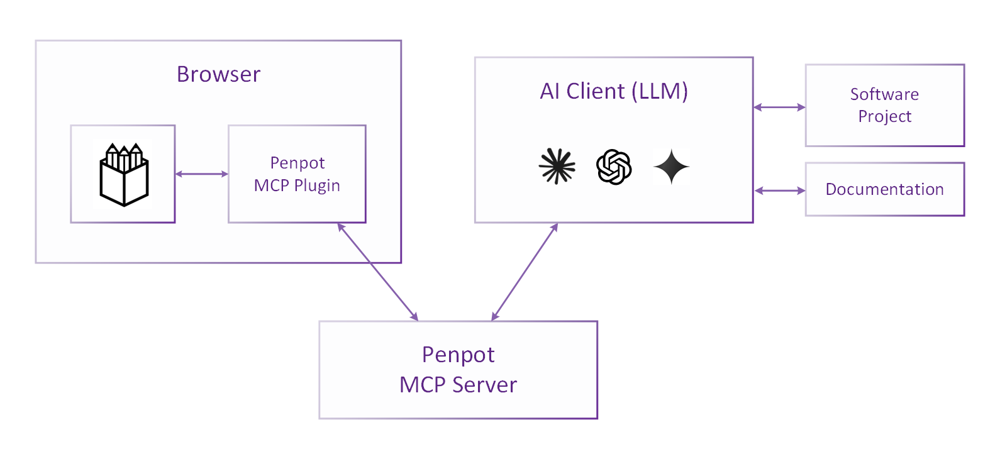

# Logos's Official MCP Server

Logos integrates a LLM layer built on the Model Context Protocol
(MCP) via Logos's Plugin API to interact with a Logos design
file. Logos's MCP server enables LLMs to perfom data queries,
transformation and creation operations.

Logos's MCP Server is unlike any other you've seen. You get
design-to- design, code-to-design and design-code supercharged
workflows.


[](https://www.youtube.com/playlist?list=PLgcCPfOv5v57SKMuw1NmS0-lkAXevpn10)


## Architecture

The **Logos MCP Server** exposes tools to AI clients (LLMs), which
support the retrieval of design data as well as the modification and
creation of design elements.  The MCP server communicates with Logos
via the dedicated **Logos MCP Plugin**,
which connects to the MCP server via WebSocket.  
This enables the LLM to carry out tasks in the context of a design file by 
executing code that leverages the Logos Plugin API.
The local, authenticated profile can execute tasks through the Logos Plugin API.
Remote and multi-user execution are disabled; the local listener is not a remote
code-execution service.



This repository thus contains not only the MCP server implementation itself
but also the supporting Logos MCP Plugin 
(see section [Repository Structure](#repository-structure) below).

## Demonstration

[](https://v32155.1blu.de/logos/LogosFest2025.mp4)


## Usage

To use the Logos MCP server, you must
 * run the MCP server and connect your AI client to it,
 * run the web server providing the Logos MCP plugin, and
 * open the Logos MCP plugin in Logos and connect it to the MCP server. 

Follow the steps below to enable the integration.


### Prerequisites

The project requires [Node.js](https://nodejs.org/) (tested with v22.x
with corepack).

Following the installation of Node.js, the tools `pnpm` and `npx`
should be available in your terminal. For ensure corepack installed
and enabled correctly, just execute the `./scripts/setup`.

It is also required to have `caddy` executeable in the path, it is
used for start a local server for generate types documentation from
the current branch. If you want to run it outside devenv where all
dependencies are already provided, please download caddy from
[here](https://caddyserver.com/download).

You should probably be using logos devenv, where all this
dependencies are already present and correctly setup. But nothing
prevents you execute this outside of devenv if you satisfy the
specified dependencies.


### 1. Build & Launch the MCP Server and the Plugin Server

If it's your first execution, install the required dependencies:

```shell
cd mcp/
./scripts/setup
```

Then build all components and start the two servers:

```shell
export LOGOS_MCP_LOCAL_TOKEN="$(openssl rand -hex 32)"
# Optional: allow a specific trusted Logos web origin to fetch the plugin preview.
# export LOGOS_MCP_PLUGIN_ALLOWED_ORIGIN="https://design.logos.app"
pnpm run bootstrap
```

Use the same private value when configuring the local MCP client. The plugin
build embeds it for the loopback WebSocket handshake; do not publish that build.

This bootstrap command will:

  * install dependencies for all components (`pnpm -r run install`)
  * build all components (`pnpm -r run build`)
  * start all components (`pnpm -r --parallel run start`)

If you want to have types scrapped from a remote repository, the best
approach is executing the following:

```shell
LOGOS_PLUGINS_API_DOC_URL=https://doc.plugins.logos.app pnpm run build:types
pnpm run bootstrap
```

Or this, if you want skip build step bacause you have already have all
build artifacts ready (per example from previous `bootstrap` command):

```
LOGOS_PLUGINS_API_DOC_URL=https://doc.plugins.logos.app pnpm run build:types
pnpm run start
```

If you want just to update the types definitions with the plugins api doc from the
current branch:

```shell
pnpm run build:types
```

(That command will build plugins doc locally and will generate the types yaml from
the locally build documentation)

### 2. Load the Plugin in Logos and Establish the Connection

> [!NOTE]
> **Browser Connectivity Restrictions**
>
> Starting with Chromium version 142, the private network access (PNA) restrictions have been hardened,
> and when connecting to `localhost` from a web application served from a different origin
> (such as https://design.logos.app), the connection must explicitly be allowed.
>
> Most Chromium-based browsers (e.g. Chrome, Vivaldi) will display a popup requesting permission
> to access the local network. Be sure to approve the request to allow the connection.
>
> Some browsers take additional security measures, and you may need to disable them.
> For example, in Brave, disable the "Shield" for the Logos website to allow local network access.
>
> If your browser refuses to connect to the locally served plugin, check its configuration or
> try a different browser (e.g. Firefox) that does not enforce these restrictions.

1. Open Logos in your browser
2. Navigate to a design file
3. Open the Plugins menu
4. Load the plugin using the development URL (`http://127.0.0.1:4400/manifest.json` by default)
5. Open the plugin UI
6. In the plugin UI, click "Connect to MCP server".
   The connection status should change from "Not connected" to "Connected to MCP server".
   (Check the browser's developer console for WebSocket connection logs.
   Check the MCP server terminal for WebSocket connection messages.)

> [!IMPORTANT]
> Do not close the plugin's UI while using the MCP server, as this will close the connection.

### 3. Connect an MCP Client

The server is local-only and requires a bearer token. Generate a per-run secret
of at least 32 bytes and export it before starting the server and building the
local plugin. Do not commit the token or publish a plugin bundle containing it.

```sh
export LOGOS_MCP_LOCAL_TOKEN="$(openssl rand -hex 32)"
# Optional exact origin for a trusted Logos host; wildcard CORS stays disabled.
# export LOGOS_MCP_PLUGIN_ALLOWED_ORIGIN="https://design.logos.app"
```

The server binds only to loopback (`127.0.0.1` by default; `::1` is also
accepted) and provides:

- **Modern Streamable HTTP endpoint**: `http://127.0.0.1:4401/mcp`
- **Legacy SSE endpoint**: `http://127.0.0.1:4401/sse`
- **Authenticated plugin WebSocket**: `ws://127.0.0.1:4402`
- **Authenticated development REPL**: `http://127.0.0.1:4403`

Every HTTP/SSE/REPL request must include `Authorization: Bearer $LOGOS_MCP_LOCAL_TOKEN`.
The plugin WebSocket authenticates with a first-frame token message. Configure
the MCP client or its transport proxy to send the bearer header; clients that
cannot set authorization headers are not supported by this local profile.
Build the Logos plugin with the same `LOGOS_MCP_LOCAL_TOKEN` in its environment.

When using a client that only supports stdio transport,
a proxy like `mcp-remote` is required.

#### Using a Proxy for stdio Transport

NOTE: only relevant if you are executing this outside of devenv

The `mcp-remote` package can proxy stdio transport to HTTP/SSE, 
allowing clients that support only stdio to connect to the MCP server indirectly.

1. Install `mcp-remote` globally if you haven't already:

        npm install -g mcp-remote

2. Use `mcp-remote` to provide the launch command for your MCP client:

        npx -y mcp-remote http://127.0.0.1:4401/sse --allow-http

The proxy must be configured to attach the bearer authorization header. Do not
remove server authentication to accommodate a client that cannot do so.

#### Example: Claude Desktop

For Windows and macOS, there is the official [Claude Desktop app](https://claude.ai/download), which you can use as an MCP client.
For Linux, there is an [unofficial community version](https://github.com/aaddrick/claude-desktop-debian).

Since Claude Desktop natively supports only stdio transport, you will need to use a proxy like `mcp-remote`.
Install it as described above.

To add the server to Claude Desktop's configuration, locate the configuration file (or find it via Menu / File / Settings / Developer):

- **Windows**: `%APPDATA%/Claude/claude_desktop_config.json`
- **macOS**: `~/Library/Application Support/Claude/claude_desktop_config.json`
- **Linux**: `~/.config/Claude/claude_desktop_config.json`

Add a `logos` entry under `mcpServers` with the following content: 

```json
{
    "mcpServers": {
        "logos": {
            "command": "npx",
            "args": ["-y", "mcp-remote", "http://127.0.0.1:4401/sse", "--allow-http"]
        }
    }
}
```

After updating the configuration file, restart Claude Desktop completely for the changes to take effect.

> [!IMPORTANT] 
> Be sure to fully quit the app for the changes to take effect; closing the window is *not* sufficient.   
> To fully terminate the app, choose Menu / File / Quit.

After the restart, you should see the MCP server listed when clicking on the "Search and tools" icon at the bottom
of the prompt input area.

#### Example: Claude Code

To add the Logos MCP server to a Claude Code project, issue the command

    claude mcp add logos -t http http://127.0.0.1:4401/mcp

## Repository Structure

This repository is a monorepo containing four main components:

1. **Common Types** (`common/`):
    - Shared TypeScript definitions for request/response protocol
    - Ensures type safety across server and plugin components

2. **Logos MCP Server** (`mcp-server/`):
    - Provides MCP tools to LLMs for Logos interaction
    - Runs a WebSocket server accepting connections from the Logos MCP plugin
    - Implements request/response correlation with unique task IDs
    - Handles task timeouts and proper error reporting

3. **Logos MCP Plugin** (`logos-plugin/`):
    - Connects to the MCP server via WebSocket
    - Executes tasks in Logos using the Plugin API
    - Sends structured responses back to the server#

4. **Helper Scripts** (`python-scripts/`):
    - Python scripts that prepare data for the MCP server (development use)

The core components are written in TypeScript, rendering interactions with the
Logos Plugin API both natural and type-safe.

## Configuration

The Logos MCP server can be configured using environment variables. All configuration
options use the `LOGOS_MCP_` prefix for consistency.

### Server Configuration

| Environment Variable               | Description | Default |
|------------------------------------|-------------|---------|
| `LOGOS_MCP_LOCAL_TOKEN` | Required local bearer/WebSocket credential; at least 32 bytes. Use a random per-run value and keep it private. | **Required** |
| `LOGOS_MCP_SERVER_HOST` | Literal loopback bind address. Only `127.0.0.1` or `::1` is accepted. | `127.0.0.1` |
| `LOGOS_MCP_SERVER_LISTEN_ADDRESS` | Legacy alias for the bind address; loopback values only. | — |
| `LOGOS_MCP_SERVER_PORT` | Port for the HTTP/SSE server. | `4401` |
| `LOGOS_MCP_WEBSOCKET_PORT` | Port for the authenticated plugin WebSocket. | `4402` |
| `LOGOS_MCP_REPL_PORT` | Port for the authenticated development REPL. | `4403` |
| `LOGOS_MCP_REMOTE_MODE` | Remote mode is not implemented; setting this to `true` causes startup to fail. | `false` |
| `LOGOS_MCP_PLUGIN_ALLOWED_ORIGIN` | Optional exact origin allowed to fetch the local plugin preview. Wildcard CORS is disabled. | unset |

### Logging Configuration

| Environment Variable   | Description                                          | Default  |
|------------------------|------------------------------------------------------|----------|
| `LOGOS_MCP_LOG_LEVEL` | Log level: `trace`, `debug`, `info`, `warn`, `error` | `info`   |
| `LOGOS_MCP_LOG_DIR`   | Directory for log files                              | `logs`   |

### Plugin Server Configuration

| Environment Variable                      | Description                                                                             | Default      |
|-------------------------------------------|-----------------------------------------------------------------------------------------|--------------|
| `LOGOS_MCP_PLUGIN_SERVER_LISTEN_ADDRESS` | Address on which the plugin web server listens (single address or comma-separated list) | (local only) |

## Remote execution

Remote and multi-user execution are disabled pending a separately reviewed,
authenticated deployment profile. `--multi-user`, `LOGOS_MCP_REMOTE_MODE=true`,
and non-loopback bind addresses are rejected. Generic code execution is not
available to remote clients. Do not expose or proxy these listeners publicly.
